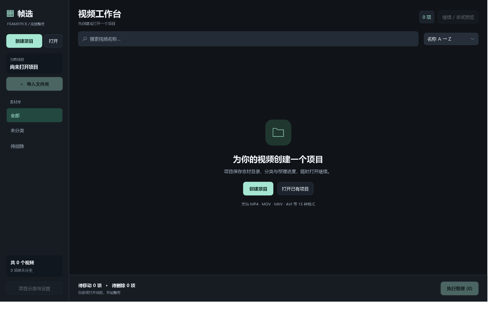

> 本目录是摄影后期工具箱内的帧选集成组件；请优先从工具箱首页打开和下载集成安装版。独立版 v1.2.0 作为来源基线保留，详见 UPSTREAM.md。

# 帧选 FramePick

基于项目的 Windows 视频预览与整理工具。导入文件夹，通过带时间标记的 **4×4 或 5×5 预览**快速分类、筛选和整理视频。



## 使用

1. 点击「新建项目」，保存为 `.framepick` 文件；也可点击「打开」继续已有项目。
2. 在项目内点击「导入文件夹」，**每次选择一个文件夹**。同一项目可累计添加多个文件夹，重复或重叠目录不会产生重复视频。
3. 打开「项目设置」，修改项目名称、选择 16/25 帧预览、填写分类名称和目标目录。这些设置与预览并发数跟随当前项目，其他项目互不影响。名称修改不重命名项目文件。
4. 在卡片下拉框中选择分类，或点击垃圾桶标记待删除。标记不会立即操作文件。
5. 左侧筛选分类，顶部搜索文件名、按名称/大小/修改时间排序。点击预览查看完整大图。
6. 核对底部数量，点击「执行整理」并确认：已分类视频移到对应目录，待删除视频送入回收站。重名自动编号，不覆盖已有文件。

快捷键：`Ctrl+N` 新建项目、`Ctrl+O` 打开项目、`Ctrl+I` 导入文件夹、`Ctrl+F` 搜索；详情中 `← →` 连续浏览、`Delete` 标记/取消删除、`Esc` 返回。

## 项目与数据

- `.framepick` 保存项目名称、导入目录、分类目标、预览帧数、并发数和整理决定；自动保存，`.framepick.bak` 保留上次保存版本。
- 项目文件引用原视频路径，不复制视频。移动项目文件后，原素材和目标目录仍需可访问。
- 同一个视频可出现在不同项目中，各项目的分类和待删除标记独立保存。
- 目录暂时离线时保留整理决定；恢复目录后重新打开项目即可继续。
- 文件大小或修改时间改变后，不套用该文件旧的分类/删除决定。
- 从旧版本升级时，可以在项目中点击「导入旧版分类与进度」，将已有设置复制进当前项目。旧数据保留。
- 配置索引和缓存默认保存在软件旁的 `Data`、`Cache`。设置 `FRAMEPICK_DATA_ROOT` 可指定其他根目录。
- 右上角「重新生成」每次先扫描全部项目目录。「只补充」复用有效预览并补齐新增、变更、失败项；「全部重新生成」重做所有当前视频。已删除或重命名的旧卡片会更新，未变文件的分类与待删除标记保留。生成中可浏览、翻页、标记和停止。

## 下载与运行

从 [Releases](https://github.com/thdlrt/FramePick/releases) 下载 Windows x64 压缩包，完整解压后运行 `FramePick.exe`。

- Windows 10/11 x64。
- 发布版包含 .NET 运行环境；请保留同目录运行库 DLL。
- 另需 `ffmpeg.exe` 和 `ffprobe.exe`：加入系统 PATH，或放到软件旁的 `tools` 文件夹。本项目不打包分发 FFmpeg。
- 支持 MP4、MOV、MKV、KMV、AVI、WMV、FLV、WebM、M4V、TS、M2TS、MPG、MPEG、3GP、VOB。

## 从源码构建

需要 .NET 8 SDK 与 FFmpeg：

```powershell
dotnet build FramePick.sln -c Release

# 核心测试：生成独立合成样例，验证扫描、预览、文件操作和项目存储
dotnet run --project tests/FramePick.Tests -c Release -- --large

# 界面回归：在上一步样例上验证项目隔离、分类、搜索、分页与取消恢复
dotnet run --project tests/FramePick.Tests -c Release -- --ui
```

测试默认写入系统临时目录下的独立测试目录，不扫描或整理用户原始视频。可通过 `FRAMEPICK_TEST_ROOT` 环境变量或 `--test-root <目录>` 指定测试根目录；连续执行两项测试时使用同一根目录。

发布 Windows x64：

```powershell
dotnet publish src/FramePick/FramePick.csproj -c Release -r win-x64 --self-contained true `
  -p:PublishSingleFile=true -p:IncludeNativeLibrariesForSelfExtract=false `
  -p:EnableCompressionInSingleFile=true -p:DebugType=None -p:DebugSymbols=false `
  -o output/FramePick
```

## 验证边界

回归使用合成常见容器、单帧竖屏视频和 2 GiB 扩展样例。2 GiB 样例验证大文件寻址，不代表长时长影片性能或所有编码组合的兼容性结论。

## 许可证

源码使用 [MIT License](LICENSE)。.NET 运行库和 FFmpeg 各自适用其许可证，见 [第三方说明](THIRD_PARTY_NOTICES.md)。
